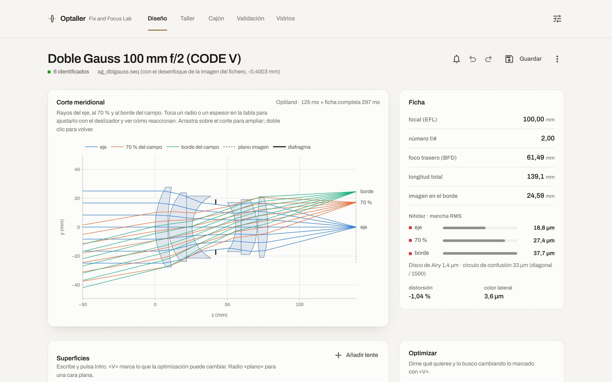
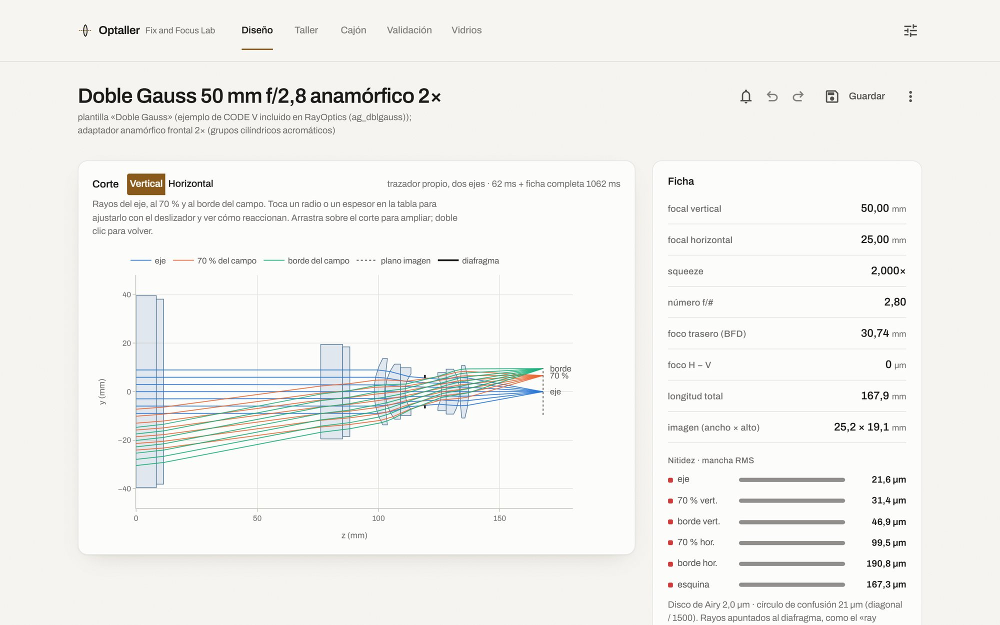
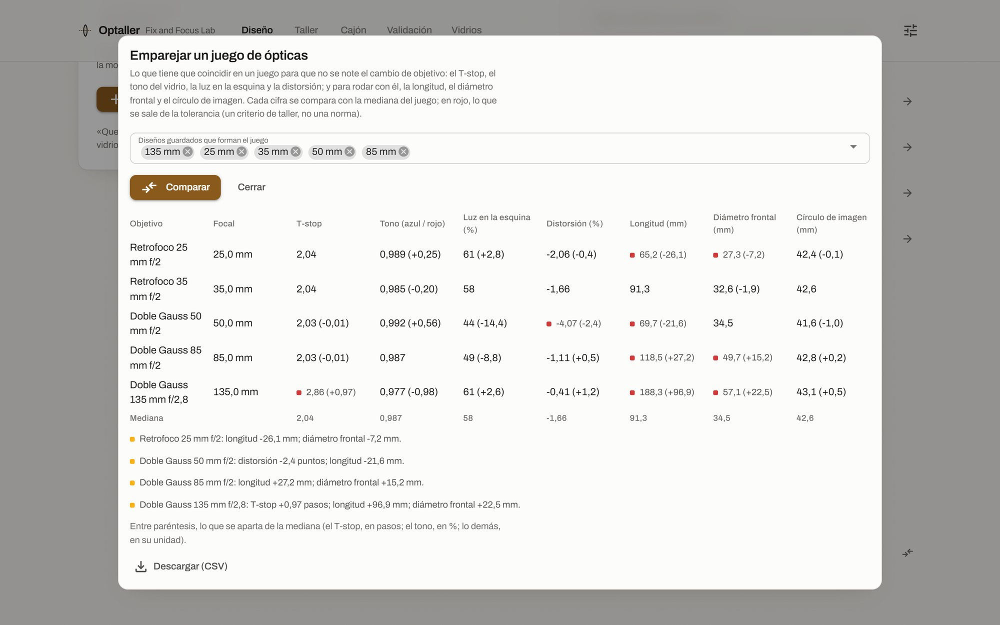
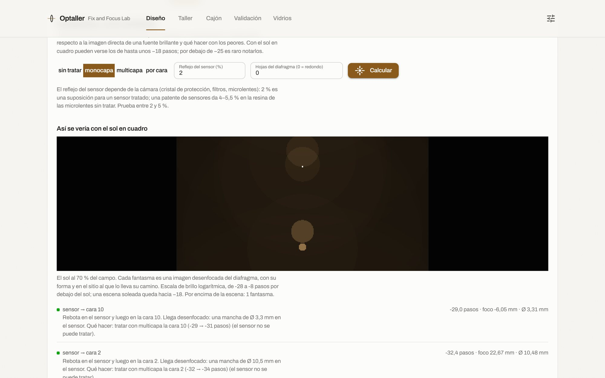
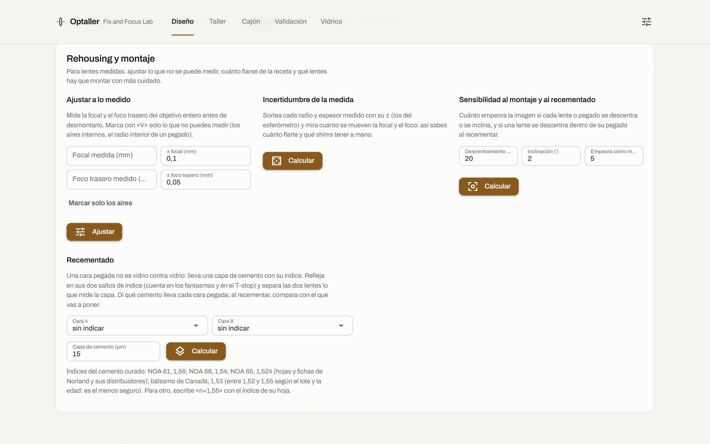
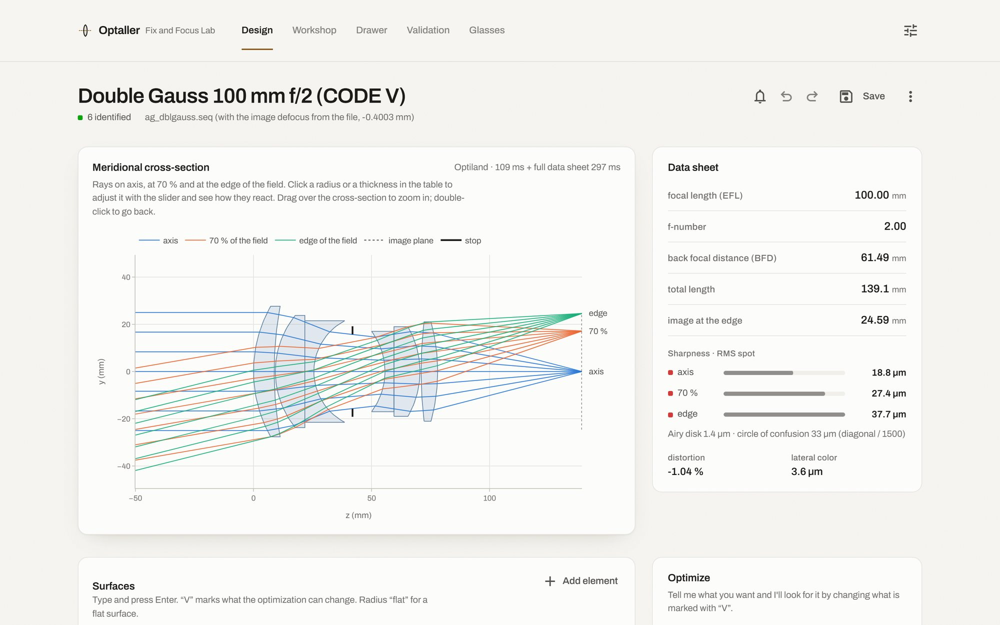

# Optaller

Diseño y análisis óptico para fotografía y cine, hecho desde un taller de ópticas (Fix and Focus
Lab, Madrid). Funciona en tu ordenador, sin conexión, con la interfaz en el navegador, en
castellano o en inglés.

**[Web del proyecto](https://fixandfocus.github.io/optaller/)** · **[Descargar](../../releases/latest)** · [English](#in-english)

[](https://fixandfocus.github.io/optaller/)

- Diseñar desde cero u optimizar, viendo reaccionar los rayos.
- Anamórficos en sus dos ejes.
- Ficha de foto y cine: MTF, T-stop, iluminación y cobertura de formatos.
- Validación cruzada entre motores (Optiland, RayOptics y un trazador propio).
- Fantasmas con el tratamiento de cada cara, bokeh, enfoque, respiración y leva de enfoque.
- Rehousing y mecánica: planos ISO 10110, STEP, DXF y atermalización de la carcasa.
- Recementado: qué cemento conviene en cada cara pegada, y el antes y el después.
- «Detuning»: dar la vuelta a una lente, abrir un aire o quitar un tratamiento, y ver lo que cambia
  (luz, fantasmas, bokeh y nitidez) frente a una referencia.
- Mapas de distorsión y de sombreado para VFX, y vista previa sobre una foto.
- Emparejar un juego de ópticas: T-stop, tono, distorsión y medidas.
- La MTF medida en el banco, comparada con la de diseño: pegada, o abriendo los ficheros de Trioptics
  ImageMaster o de MTF Mapper.
- Medir la MTF en la foto de un borde inclinado (ISO 12233), con avisos de lo que falsea la medida;
  también sobre el bruto de la cámara sin revelar (DNG, ARW, CR3, NEF…).
- Barrido de foco: de una serie de fotos, el mejor foco (el error de tiraje) y su margen. Y con varios
  barridos (tangencial y sagital, eje y borde, un lado y otro), el astigmatismo, la curvatura de campo y
  la inclinación del plano de imagen, medidos.
- Hoja de encargo: lo que pide el cliente, comprobado contra el diseño, con lista de entrega.
- Paleta de órdenes con Ctrl+K, y un servidor MCP para manejarlo desde Claude.

Este repositorio tiene los programas ya compilados, la licencia, la web y estas instrucciones.
El código no es público. Hasta la versión 0.4 el programa se llamaba disenooptico.

| | |
|---|---|
|  |  |
|  |  |

## Descargar

En **[Releases](../../releases/latest)**, la última versión:

- **Windows** (x64): `optaller-<versión>-windows-x64.zip`
- **macOS** (Apple Silicon, macOS 14 Sonoma o posterior): `optaller-<versión>-macos-arm64.dmg`

Los Mac con procesador Intel no están: numba, una de las librerías que usa, ya no publica
versiones para ellos.

## Abrirlo

- **Windows**: descomprime el .zip en cualquier carpeta y abre `optaller\optaller.exe`.
  Se abre una pestaña del navegador con el programa. Se queda una consola minimizada:
  cerrarla cierra el programa.
- **macOS**: abre el .dmg y arrastra `Optaller` a Aplicaciones. Para cerrarlo: Ajustes
  (el icono de arriba a la derecha) → «Cerrar el programa»; o cierra todas sus pestañas y
  se cierra solo a los dos minutos.

El idioma se elige en Ajustes → «Idioma · Language». La primera vez sigue al del sistema.

### La primera vez (no va firmado)

El programa no está firmado con un certificado de desarrollador, así que el sistema avisa
la primera vez:

- **Windows**: «Windows protegió su PC» → «Más información» → «Ejecutar de todas formas».
  Si Windows 11 tiene activado «Control inteligente de aplicaciones», lo bloquea sin dar
  esa opción.
- **macOS**: dice que no se puede comprobar. Pulsa «Listo», ve a Ajustes del Sistema →
  Privacidad y seguridad → «Abrir igualmente» y confirma con la contraseña. Desde una
  terminal también vale: `xattr -dr com.apple.quarantine /Applications/Optaller.app`.

### Dónde guarda los datos

- Windows: `%LOCALAPPDATA%\optaller`.
- macOS: `~/Library/Application Support/optaller` y `~/Library/Caches/optaller`.
- Los diseños que guardas, en `Documentos/Optaller`.

Si venías de disenooptico (hasta la 0.4), la primera vez que abras Optaller renombra esas
carpetas y conserva todo: ajustes, borrador, cajón, historial y diseños.

### Qué no lleva esta versión

El diseño «desde lentes planas» con PyTorch, y DeepLens en la validación cruzada: ahí
sale como «no está instalado en esta versión». La validación sigue con Optiland, RayOptics
y el trazador propio.

Lo que se exporta (planos, CSV, lista de entrega, mapas para VFX, informes) sale en el idioma
de la interfaz; los textos de los DXF, en castellano.

### Sin interfaz, por lotes

Para una carpeta de recetas (.zmx, .seq, .json), la ficha de cada una en un CSV y, si se
pide, planos, STEP, .zmx y validación. Con `--juego`, además, las compara como un juego de
ópticas. En Windows:

```
optaller\optaller.exe lote CARPETA --todo
```

### Desde Claude (servidor MCP)

`optaller mcp` deja manejar el programa desde Claude: crear un diseño de partida, abrir una
receta, sacar su ficha, optimizarla, validarla, exportarla, comprobar un encargo y comparar un
juego de ópticas. Para darlo de alta, la orden es la ruta del ejecutable
(`…\optaller\optaller.exe` en Windows, `/Applications/Optaller.app/Contents/MacOS/optaller` en
macOS) con el argumento `mcp`.

## Licencia

**Uso libre para particulares, para sí mismos.** Las empresas y el uso profesional
(también como autónomo) necesitan una licencia de pago, que se pide a través de este perfil
de GitHub: [github.com/FixAndFocus](https://github.com/FixAndFocus).

El texto que vale es [LICENCIA.md](LICENCIA.md); [LICENSE.md](LICENSE.md) es su traducción
al inglés. Los componentes de software libre que lleva dentro conservan sus licencias
(LICENCIAS_DE_TERCEROS.txt, dentro de cada descarga).

## Fallos y sugerencias

En [Issues](../../issues) de este repositorio. Para una licencia comercial, también.

---

## In English

Optaller is optical design and analysis software for photo and cinema lenses, made in a lens
workshop (Fix and Focus Lab, Madrid). It runs on your computer, offline, with its interface in
the browser, in Spanish or English (Settings → “Idioma · Language”).

**[Project page](https://fixandfocus.github.io/optaller/)** · **[Download](../../releases/latest)**

[](https://fixandfocus.github.io/optaller/)

- Design from scratch or optimize, watching the rays react. Anamorphics in their two axes.
- Photo and cinema data sheet: MTF, T-stop, illumination, format coverage.
- Cross-validation between engines (Optiland, RayOptics and an in-house ray tracer).
- Ghosts with the coating of each surface, bokeh, focus breathing and the focus cam.
- Rehousing and mechanics: ISO 10110 drawings, STEP, DXF, athermalization; recementing,
  “detuning”, lens-set matching; distortion and shading maps for VFX.
- Measured MTF against the design MTF (typed, or from Trioptics ImageMaster and MTF Mapper files); a
  requirements sheet checked against the design.
- MTF measured from the photo of a slanted edge (ISO 12233), with warnings about what distorts it; also on
  the undeveloped camera raw file (DNG, ARW, CR3, NEF…). Focus sweep: best focus and its margin from a
  series of photos; with several sweeps, measured astigmatism, field curvature and image-plane tilt.
- Command palette (Ctrl+K), and an MCP server (`optaller mcp`) to drive it from Claude.

**Download** the latest build from [Releases](../../releases/latest): on Windows (x64), unzip it
and open `optaller\optaller.exe`; on macOS (Apple Silicon, macOS 14 or later), open the .dmg and
drag Optaller to Applications. The builds are not signed, so the system warns the first time:
on Windows, “More info” → “Run anyway”; on macOS, System Settings → Privacy & Security → “Open
Anyway”. Exported files (drawings, CSV, checklists, VFX maps, reports) follow the interface
language.

**Free for private individuals for personal use; companies and professional use (including
self-employed) need a paid licence**: ask through
[github.com/FixAndFocus](https://github.com/FixAndFocus). The binding licence text is
[LICENCIA.md](LICENCIA.md) (Spanish); [LICENSE.md](LICENSE.md) is an informative translation.
The code is not public. Until version 0.4 the program was called disenooptico.
